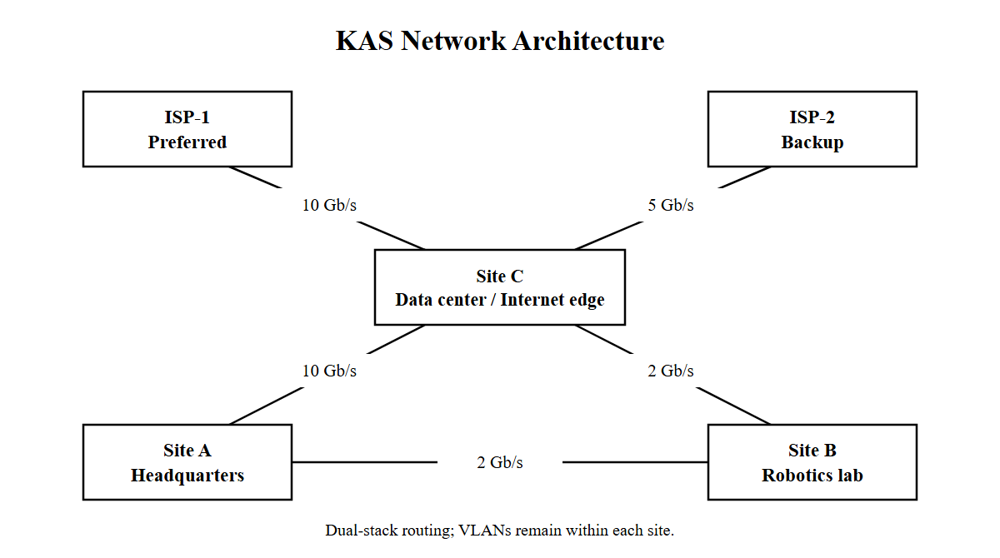

## 1. Requirements, Architecture, and Design Decisions

### 1.1 Executive summary

The KAS design provides a common IPv4/IPv6 network for headquarters at Site A, the robotics lab at Site B, and the data center at Site C. Each site uses a Layer-3 distribution switch for local VLAN gateways and a router for inter-site traffic. Shared applications, DNS, the software repository, monitoring, and Internet access reside at C, making dependable access to the data center a priority.

Within each site, VLANs and gateway ACLs separate device roles while allowing required services. Guests can reach the Internet but not KAS application networks, and robotics access is limited to approved control, management, and service traffic. Keeping all fourteen VLANs local to their sites also contains broadcasts and Layer-2 failures. Each VLAN supports both IP versions, with IPv4 capacity for at least 25% device growth plus its gateway and an IPv6 /64. Contiguous site allocations leave room for further expansion.

Between sites, OSPFv2 and OSPFv3 provide automatic route selection within one backbone area. This keeps administration manageable for six routing devices, while retaining individual prefixes rather than inter-area summaries. Matching costs make both protocols prefer the direct 10 Gb/s A-C link. If that link fails, traffic takes the two 2 Gb/s links through B, preserving access to C at lower capacity and greater delay.

Internet access follows the same preference for a primary path and an available backup. At RC, BGP prefers the 10 Gb/s ISP for outbound traffic and retains the 5 Gb/s ISP as an alternative. AS-path prepending encourages the corresponding inbound preference, subject to external policies. Default-only imports limit routing state, and public-aggregate export filters prevent provider-to-provider transit. RC also performs NAT44 for private IPv4 clients; public servers and IPv6 traffic need no translation. Retaining NAT mappings during ISP failover allows existing IPv4 sessions to resume if bidirectional routing recovers before timeout.

These alternate circuits improve availability, but local device redundancy remains limited to control cost and complexity. Single access uplinks avoid normal STP blocking, while the sole distribution switch at each site remains a gateway failure point. RC is likewise a shared dependency despite its two providers. The first proposed upgrade is a second distribution switch and redundant dual-stack gateways at B to protect robotics access.

The IPMininet results support the routed portion of this design: both IP versions established connectivity and regained reachability through B after A-C failed, and TCP connection establishment was observed. The model excludes production switching, BGP, and NAT, so those functions remain unvalidated. Recovery duration and active TCP survival were also unmeasured. Because the virtual links lack production capacity and delay limits, their throughput cannot establish physical-WAN performance.

### 1.2 Architecture overview

*Figure 1.1. Three-site architecture with a routed WAN triangle and two Internet providers at Site C.*

### 1.3 Design goals

- **Availability:** maintain connectivity after one WAN-link or provider failure.
- **Segmentation:** isolate guests and robotics; allow only required application and management traffic.
- **Performance:** prefer the higher-capacity A-C and ISP-1 paths.
- **Simplicity and cost:** minimize device count and routing configuration.
- **Growth:** allow at least 25% IPv4 endpoint growth and reserve space for new VLANs and sites.
- **Dual stack:** provide equivalent access policies and dynamic routing for IPv4 and IPv6.

**Tradeoff:** availability requires redundancy, while simplicity and cost favor fewer devices. This design provides alternate circuits but accepts single local gateways and one Internet-edge router.

### 1.4 Material assumptions

- **Population:** 60 users per A floor, 80 concurrent guests, and 40 internal plus 10 public servers at C.
- **Services:** guest wireless and phones only at A; shared DNS, applications, repository, and call control in C's internal-server VLAN; monitoring in C's management VLAN.
- **Equipment:** distribution switches support dual-stack SVIs, ACLs, OSPF, and STP. Routers support IPv6 /127 links; RC also supports dual-stack BGP and NAT44. Models and port counts remain unspecified.
- **Capacity:** distribution-to-router links are 10 Gb/s. Access speeds are unspecified; the 10 Gb/s throughput calculation assumes no slower link or endpoint.
- **Providers:** both supply IPv4/IPv6 defaults and accept KAS aggregates. Transit addresses are assumed assignments. External routing policies may override the intended inbound preference.
- **NAT:** RC stays operational and retains its public address, translated ports, and mappings during ISP failover. This remains untested.
- **Robotics:** telemetry tolerates occasional sample loss; fast control stays local. Supervisory UDP applications provide sequencing, expiry, required acknowledgments, and congestion response.
- **Packet calculations:** Ethernet links, TTL/Hop Limit 64, no fragmentation or QoS remarking. The supplied RTT is 12 ms; the 1,460-byte payload assumes minimum IPv4/TCP headers. Estimates omit TLS overhead, setup, loss, and ACK serialization.
- **Failures:** one component fails at a time; all others remain operational. Post-convergence pings do not establish recovery time or active TCP survival.

### 1.5 Alternatives considered

1. **One OSPF area instead of separate site areas.** Placing each site's LANs in a separate area, with its router acting as an ABR, would allow site-prefix summarization. We rejected this option because the small six-device network gains little from reducing routing state, while area boundaries add configuration and troubleshooting work. Area 0 therefore carries individual prefixes; the reserved site blocks allow aggregation if the network later expands.
2. **Single distribution switches and access uplinks instead of redundant pairs.** Two distribution switches per site, dual access uplinks, and virtual gateways would protect against a local switch failure. This alternative was rejected for the initial design because it adds switches, links, and coordination between gateway failover and STP. The simpler design accepts local gateway outages; adding redundancy at B remains the first proposed upgrade.
3. **Default-only BGP instead of full Internet tables.** Full tables would allow destination-specific provider selection. That capability is unnecessary for the chosen policy of preferring ISP-1 and using ISP-2 as backup. We rejected full-table imports because they increase routing state and policy maintenance without being needed for that policy; two default routes per address family provide the required provider choice.
