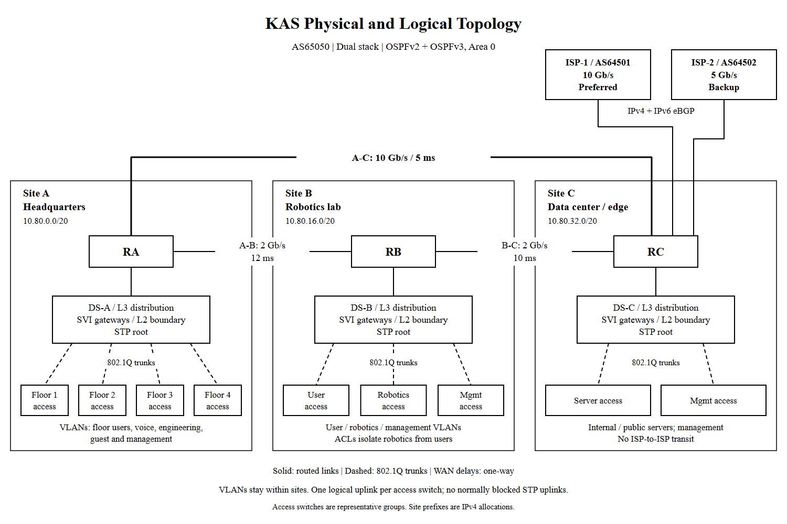

## 2. Physical, Layer-2, and Segmentation Design

### 2.1 Physical and logical topology

Each site's access switches connect to a single Layer-3 distribution switch: DS-A, DS-B, or DS-C. These switches provide the local VLAN gateways and connect through routed links to RA, RB, and RC. The three routers form the WAN triangle, with RC also connecting to both Internet providers at Site C.

*Figure 2.1. Physical and logical topology showing site devices, VLAN boundaries, and WAN and Internet circuits.*

Solid lines show routed links; dashed lines show 802.1Q trunks. VLANs end at the local distribution switch.

| Circuit | Capacity | One-way delay / role |
| --- | --- | --- |
| A-C | 10 Gb/s | 5 ms; primary high-capacity path |
| A-B | 2 Gb/s | 12 ms |
| B-C | 2 Gb/s | 10 ms |
| RC to ISP-1, AS64501 | 10 Gb/s | Preferred Internet provider |
| RC to ISP-2, AS64502 | 5 Gb/s | Backup Internet provider |

The access-switch boxes represent groups. Site A groups access by floor, while Sites B and C group it by device role. Within each group, every physical access switch has one logical uplink to its local distribution switch, keeping all access links within the site.

### 2.2 VLAN plan and default gateways

Each production VLAN has an IPv4 subnet and an IPv6 /64, with both default gateways provided by a switched virtual interface (SVI) on the local distribution switch. The table below identifies each VLAN's role and normal traffic path; [Section 3](03_addressing.md) lists its subnet and gateway addresses.

| Site | VLAN | Purpose | Gateway location | Normal traffic path |
| --- | --- | --- | --- | --- |
| A | 110 | Floor 1 ordinary users | DS-A, SVI 110 | Same-VLAN traffic stays local; applications and Internet traffic cross the WAN to C. |
| A | 120 | Floor 2 ordinary users | DS-A, SVI 120 | Same as VLAN 110. |
| A | 130 | Floor 3 ordinary users | DS-A, SVI 130 | Same as VLAN 110. |
| A | 140 | Floor 4 ordinary users | DS-A, SVI 140 | Same as VLAN 110. |
| A | 150 | IP phones | DS-A, SVI 150 | Phone-to-phone media stays local when both endpoints are in this VLAN; call control crosses the WAN to C. |
| A | 160 | Engineering lab devices | DS-A, SVI 160 | Local lab traffic; repository access to C and approved robot-control traffic to B cross the WAN. |
| A | 170 | Guest wireless clients | DS-A, SVI 170 | Internet traffic crosses the WAN to the edge at C; no access to KAS application networks. |
| A | 180 | Infrastructure and management | DS-A, SVI 180 | Local device administration; central monitoring and approved remote administration cross the WAN. |
| B | 210 | Ordinary users | DS-B, SVI 210 | Same-VLAN traffic stays local; applications and Internet traffic cross the WAN to C. |
| B | 220 | Robots and embedded test systems | DS-B, SVI 220 | Robot/test exchanges stay local where possible; telemetry and repository access cross the WAN to C. |
| B | 230 | Infrastructure and management | DS-B, SVI 230 | Local device administration; central monitoring and approved remote administration cross the WAN. |
| C | 310 | Internal production services: shared DNS, software repository, applications, call control | DS-C, SVI 310 | Server-to-server traffic stays local; requests and replies for A/B traverse the WAN. |
| C | 320 | Public-facing production services | DS-C, SVI 320 | Public service traffic uses RC and an ISP; approved management traffic stays local or arrives from A/B. |
| C | 330 | Infrastructure, management, and central monitoring | DS-C, SVI 330 | Local administration at C; monitoring and approved administration of A/B traverse the WAN. |

At Site A, user VLANs are confined to individual floors, while voice, engineering, guest, and management VLANs extend to the floors that need them. Guest wireless and IP phones are deployed only at A, with call control hosted in C's internal-server VLAN. At C, VLANs 310 and 320 separate the existing server population into internal and public-facing services.

### 2.3 Communication between VLAN classes

Access between VLANs is denied unless permitted below. Distribution-switch SVI access control lists (ACLs) enforce this policy for both IPv4 and IPv6. Rules cover traffic entering and leaving the VLANs, so requests arriving from another site face the same restrictions as local requests.

| VLAN class | Permitted communication | Restrictions |
| --- | --- | --- |
| Ordinary users: 110, 120, 130, 140, 210 | Designated DNS and application services in 310; published services in 320; Internet web access through RC. | No direct access to other user VLANs, engineering, voice, guests, robotics, or management VLANs. |
| Voice: 150 | Call-control, DNS, and time services on designated hosts in 310; local phone media within 150. | No general access to user, engineering, guest, robotics, public-server, or management VLANs; no direct Internet access. |
| Engineering: 160 | Internal DNS/applications/repository in 310, published services in 320, and Internet web access. Named engineering control workstations may access designated robots in 220 on approved control/test ports. | Other engineering devices cannot access robotics. No general access to ordinary users, voice, guests, or management VLANs. |
| Guests: 170 | Internet web access and external DNS, plus local address-configuration and neighbor-discovery traffic. | Deny all KAS destination prefixes, including public IPv4 and global IPv6 prefixes. Enable wireless client isolation to prevent guest-to-guest access. |
| Robotics: 220 | Designated telemetry collectors, repository, DNS, and time services in 310; logs to the monitoring host in 330. | No general access to user, engineering, guest, voice, or public-server VLANs, and no direct Internet access. Permit replies for approved engineering control and management flows. |
| Internal servers: 310 | Provide the listed services to authorized clients; send logs to 330; use approved external update/time services. | No unrestricted server-initiated access to client, robotics, public-server, or management networks. |
| Public servers: 320 | Serve published HTTPS services to Internet and authorized internal clients; send logs to a designated collector in 330; use approved external DNS/update/time services. | Deny other access to internal KAS VLANs. Administrative access is permitted only from named management hosts. |
| Management: 180, 230, 330 | Named administrator hosts may manage designated infrastructure and servers using SSH/HTTPS. The central monitor in 330 may poll designated devices using SNMPv3/ICMP; managed devices may send logs to it. Permit internal DNS/time and approved updates. | Membership in a management VLAN does not grant unrestricted access. Scope rules to specific source hosts, destination devices, and management services. No routine access to guests. |

The table describes application flows; reply traffic also needs explicit ACL entries because ordinary switch ACLs are stateless. These entries are limited to the relevant hosts and services, including UDP replies, but do not validate session state. The policy also allows necessary ARP, IPv6 Neighbor Discovery and router advertisements, address configuration, and ICMP/ICMPv6 errors to support connectivity and path-MTU discovery.

SVI ACLs apply only to routed traffic. Devices in the same VLAN communicate directly, so VLAN 220 separates robotics from other classes but leaves communication between robots within that VLAN unrestricted by the SVI ACL. Guest-to-guest restrictions are instead enforced through wireless client isolation.

### 2.4 Trunks, access ports, and routing boundaries

Access-switch uplinks to DS-A, DS-B, and DS-C use IEEE 802.1Q trunks. Frame tags identify the VLAN, allowing each uplink to carry several VLANs while keeping their traffic separate. Each trunk permits only the VLANs required by its devices and switch management.

| Access group | VLANs permitted on its distribution uplink |
| --- | --- |
| A, floor 1 / 2 / 3 / 4 | Its floor-user VLAN: 110 / 120 / 130 / 140, respectively; management 180; voice 150, engineering 160, and guest 170 only where needed. |
| B, user access | 210 and 230 |
| B, robotics access | 220 and 230 |
| B, management access | 230 |
| C, server access | 310, 320, and 330 |
| C, management access | 330 |

Endpoint ports use the following assignments:

- **Ordinary devices:** untagged access ports in one VLAN.
- **Phones with attached computers:** tagged voice VLAN 150 and untagged data in the floor-user VLAN.
- **Guest access points:** guest VLAN 170 and management VLAN 180, with the guest SSID mapped to 170.

Management VLANs carry switch and access-point administration; ordinary endpoints use their assigned device VLANs. All production VLANs are tagged on switch-to-switch trunks. VLAN 1 is unused for production, and unused ports are disabled.

The destination determines where forwarding occurs:

- **Same VLAN:** the access and distribution switches forward traffic locally at Layer 2.
- **Different VLAN, same site:** the distribution switch routes traffic through its SVIs, subject to ACLs.
- **Different site:** the distribution switch forwards permitted traffic to the site router and across the WAN.

For example, an engineering workstation reaches the repository through `VLAN 160 -> DS-A -> RA -> RC -> DS-C -> VLAN 310` over the normal A-C path.

The distribution-to-router and WAN links carry routed traffic, so VLAN broadcast domains stop at the local distribution switch. Ethernet broadcasts, ARP, and IPv6 link-local discovery stay within their local Layer-2 domains. OSPFv2 and OSPFv3 provide alternate WAN paths in Area 0 without extending VLANs between sites.

### 2.5 Spanning tree and failure tradeoff

DS-A, DS-B, and DS-C are the preferred spanning-tree protocol (STP) roots at their respective sites. Each access switch has one logical uplink and no links to other access switches, giving the intended Layer-2 topology no loops. Access uplinks therefore forward as root ports, and distribution downlinks forward as designated ports; no uplink is normally blocked. STP remains enabled to protect against accidental redundant connections. Endpoint-facing ports use edge-port behavior and BPDU Guard; switch-to-switch links use normal STP participation without these endpoint settings.

This simple topology accepts local outages in exchange for fewer switches and links. An uplink failure disconnects its access switch, while a distribution-switch failure removes the site's VLAN gateways. At B, either a DS-B failure or a VLAN 220 SVI failure interrupts routed robotics access because there is no backup gateway. STP cannot replace a failed path in this topology, and the WAN triangle protects only against WAN-link failures. The effect on robotics and the proposed gateway upgrade are covered in [Section 8](08_failure_analysis.md).

