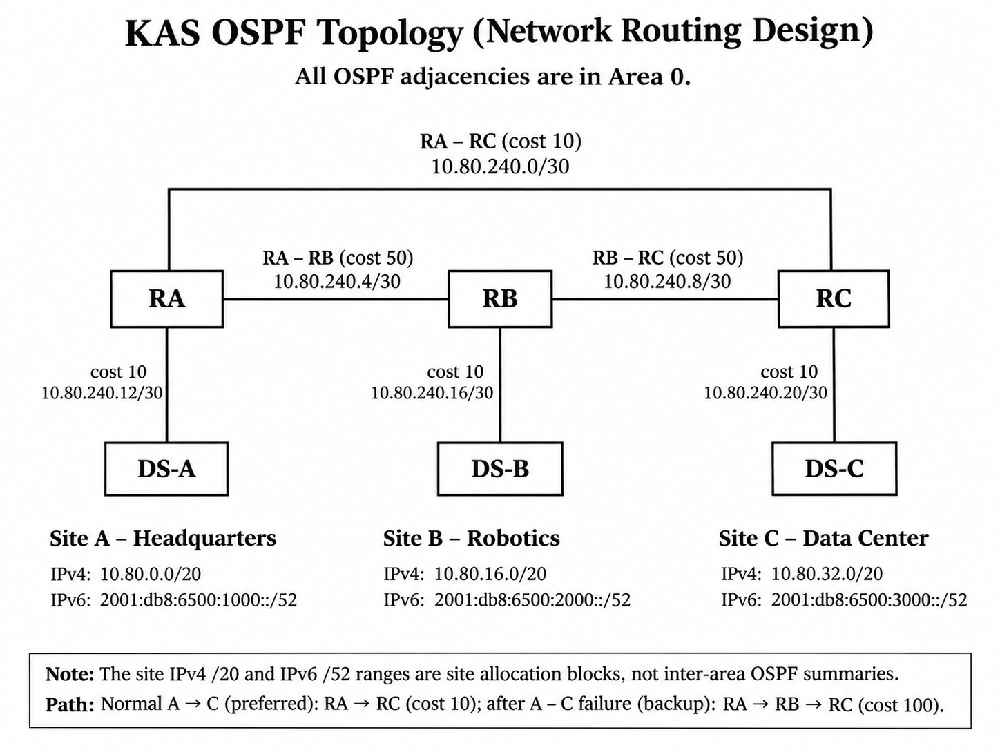

## 4. Internal Routing and Forwarding

### 4.1 OSPF design and link costs

KAS uses OSPFv2 for internal IPv4 routing and OSPFv3 for internal IPv6 routing. The three site routers (RA, RB, and RC) and the three Layer-3 distribution switches (DS-A, DS-B, and DS-C) operate in a single backbone area, Area 0. A single-area design is adequate for six internal routing devices and avoids the additional complexity of area border routers and inter-area route distribution.

RA, RB, and RC form OSPF adjacencies over the three routed WAN links. Each site router also forms an adjacency with its corresponding distribution switch. The distribution switches advertise their connected VLAN prefixes, and all six routers advertise their loopbacks. VLAN SVIs and loopbacks are passive OSPF interfaces; only the point-to-point routed links form adjacencies. OSPFv2 and OSPFv3 use the same configured link costs to provide consistent dual-stack path selection.

The OSPF reference bandwidth is **100 Gb/s**. We assign the interface cost using

$$
\text{Cost} = \frac{\text{Reference bandwidth}}{\text{Link bandwidth}}
$$

| Routed link | Bandwidth | Calculation | OSPF cost (each direction) |
| --- | ---: | --- | ---: |
| RA–RC | 10 Gb/s | 100/10 | 10 |
| RA–RB | 2 Gb/s | 100/2 | 50 |
| RB–RC | 2 Gb/s | 100/2 | 50 |
| DS-A–RA | 10 Gb/s (assumed) | 100/10 | 10 |
| DS-B–RB | 10 Gb/s (assumed) | 100/10 | 10 |
| DS-C–RC | 10 Gb/s (assumed) | 100/10 | 10 |

The WAN bandwidths are given design parameters. The 10 Gb/s capacities assigned to the distribution-switch-to-router links are additional assumptions. These links must be configured explicitly with cost 10 in both routing protocols rather than relying on a router's unverified default reference bandwidth.

Each site has a reserved private IPv4 /20 and global IPv6 /52 allocation block (A: `10.80.0.0/20`, `2001:db8:6500:1000::/52`; B: `10.80.16.0/20`, `2001:db8:6500:2000::/52`; C: `10.80.32.0/20`, `2001:db8:6500:3000::/52`). **These are address-allocation blocks, not advertised OSPF summary routes.** In the single-area design, OSPF advertises the individual VLAN, routed-link, and loopback prefixes, including Site C's public-server subnet.

### 4.2 Least-cost paths and ECMP

For the **site-router-to-site-router** paths, the OSPF cost is the sum of outgoing-interface costs along the route.

| Source and destination | Normal direct path | Alternative via the third site | Selected normal path |
| --- | --- | --- | --- |
| RA → RC | RA–RC: 10 | RA–RB–RC: 50 + 50 = 100 | RA–RC |
| RB → RC | RB–RC: 50 | RB–RA–RC: 50 + 10 = 60 | RB–RC |

If the A–C link fails, the RA–RC route is removed. The available RA-to-RC route is **RA–RB–RC with cost 100**. The backup WAN path is limited by the 2 Gb/s links and has a one-way WAN propagation delay of `12 ms + 10 ms = 22 ms`, compared with 5 ms along the normal direct link. These figures exclude local-link, serialization, queuing, and processing delays.

For a **complete path between distribution switches**, include the additional costs at both ends. A Site A engineering workstation reaching the Site C repository follows DS-A–RA–RC–DS-C with cost `10 + 10 + 10 = 30`. After A–C fails, DS-A–RA–RB–RC–DS-C has cost `10 + 50 + 50 + 10 = 120`. Similarly, DS-B–RB–RC–DS-C has cost `10 + 50 + 10 = 70`, compared with `10 + 50 + 10 + 10 = 80` through Site A. The different totals simply reflect different endpoints; they do not change the route preference.

Because OSPFv3 uses the same interface costs as OSPFv2, the normal and failure paths are identical for IPv4 and IPv6. **No equal-cost alternative path exists anywhere in this modeled topology**: the WAN alternatives have unequal costs, and each site distribution switch is connected to only one site router. Thus, ECMP is not used. This is intentional: traffic normally uses the direct A–C high-capacity link, while the A–B–C route remains a backup.

### 4.3 Expected IPv4 and IPv6 RIB/FIB entries on RA

The routing information base (RIB) records the selected connected, local, OSPF-learned, and default routes. The forwarding information base (FIB) resolves each selected destination into an outgoing interface and next hop. The tables below show **expected design entries under normal conditions**, not captured IPMininet output. Representative prefixes are shown rather than every VLAN and loopback.

**IPv4 (RA)**

| Destination | RIB source | FIB next hop | Outgoing connection |
| --- | --- | --- | --- |
| `10.80.241.1/32` | Local RA loopback | Local delivery | RA |
| `10.80.240.0/30` | Connected | On-link | RA–RC |
| `10.80.240.4/30` | Connected | On-link | RA–RB |
| `10.80.240.12/30` | Connected | On-link | RA–DS-A |
| `10.80.2.64/26` (A engineering) | OSPFv2 | `10.80.240.13` (DS-A) | RA–DS-A |
| `10.80.16.0/24` (B robotics) | OSPFv2 | `10.80.240.6` (RB) | RA–RB |
| `10.80.32.0/26` (C internal servers) | OSPFv2 | `10.80.240.2` (RC) | RA–RC |
| `0.0.0.0/0` | OSPFv2 external default | `10.80.240.2` (RC) | RA–RC |

**IPv6 (RA)**

| Destination | RIB source | FIB next-hop router | Outgoing connection |
| --- | --- | --- | --- |
| `2001:db8:6500:f100::1/128` | Local RA loopback | Local delivery | RA |
| `2001:db8:6500:f001::2/127` | Connected | On-link | RA–RC |
| `2001:db8:6500:f002::2/127` | Connected | On-link | RA–RB |
| `2001:db8:6500:f011::2/127` | Connected | On-link | RA–DS-A |
| `2001:db8:6500:1006::/64` (A engineering) | OSPFv3 | DS-A | RA–DS-A |
| `2001:db8:6500:2002::/64` (B robotics) | OSPFv3 | RB | RA–RB |
| `2001:db8:6500:3001::/64` (C internal servers) | OSPFv3 | RC | RA–RC |
| `::/0` | OSPFv3 external default | RC | RA–RC |

IPv6 OSPFv3 next hops are normally represented by the neighbor's link-local address. These addresses are not specified in the shared design, so the IPv6 FIB view identifies the corresponding neighbor routers rather than inventing link-local values. The IPv6 /127 prefixes above match the planned RA-facing routed links.

RC originates an IPv4 default into OSPFv2 only while a usable IPv4 Internet default is present, and an IPv6 default into OSPFv3 only while a usable IPv6 Internet default is present. RC receives those routes using the eBGP policy in Section 5; the full Internet routing table is not imported into OSPF.

For example, a Site A workstation sending an IPv4 packet to the repository at `10.80.32.10` first sends it to its local DS-A gateway. DS-A forwards it to RA (`10.80.240.14`), RA forwards it toward RC (`10.80.240.2`), and RC sends it toward DS-C (`10.80.240.21`) and the repository VLAN. The analogous IPv6 packet to `2001:db8:6500:3001::10` traverses the same routers.

### 4.4 Failure detection, reconvergence, and forwarding updates

The proposed WAN OSPF Hello Interval is **10 seconds** and Dead Interval is **40 seconds** for both OSPFv2 and OSPFv3. Both ends of every adjacency use matching settings. If RA or RC receives a physical link-down indication on A–C, failure processing can begin without waiting for the OSPF Dead Interval. If the interface stays up but Hello packets are not received, the adjacency is declared failed when the Dead Interval expires. Neither timer specifies a guaranteed end-to-end convergence time.

When RA–RC fails, RA and RC change their link-state information and flood the relevant LSAs over the remaining OSPF adjacencies. OSPFv2 and OSPFv3 each update their own link-state database and run a shortest-path-first (SPF) calculation. The RIB selects the alternative path RA–RB–RC. Only after the resulting forwarding entries are installed does the FIB forward Site C packets through RB rather than RC.

For example, the IPv4 next hop on RA for `10.80.32.0/26` changes from `10.80.240.2` (RC) to `10.80.240.6` (RB). For `2001:db8:6500:3001::/64`, the IPv6 next-hop router also changes from RC to RB over the A–B link. The distribution-switch gateways and end-system addresses remain unchanged.

Some packets may be lost during detection and convergence. TCP may retransmit data and reduce its congestion window, but an established connection can survive if the route recovers before its timeout. Once RA–RC returns and the adjacency is restored, SPF again selects the lower-cost direct path. These are expected behaviors; actual reachability and reconvergence are evaluated separately in the IPMininet validation.

### 4.5 Routing diagram

*Figure 4.1. KAS dual-stack OSPF routing topology with Area 0 adjacencies, link costs, and site address allocations. The site /20 and /52 blocks are allocation blocks rather than inter-area OSPF summaries.*
