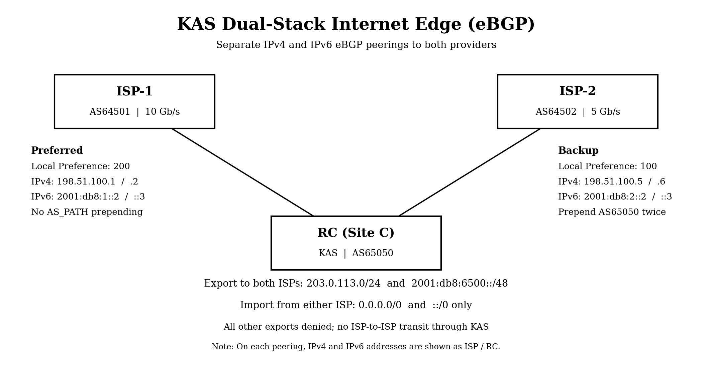

## 5. Internet Edge and Dual-Stack BGP Policy

### 5.1 eBGP Sessions and Public Prefix Advertisements

KAS operates AS65050 and connects to two transit providers at RC in Site C. ISP-1 (AS64501, 10 Gb/s) is the preferred provider, and ISP-2 (AS64502, 5 Gb/s) is the backup. RC establishes eBGP sessions for both IPv4 and IPv6 with each provider.

| Provider | Provider ASN | KAS IPv4 / ISP IPv4 | KAS IPv6 / ISP IPv6 | Role |
| --- | --- | --- | --- | --- |
| ISP-1 | AS64501 | 198.51.100.2 / 198.51.100.1 | 2001:db8:1::3 / 2001:db8:1::2 | Preferred |
| ISP-2 | AS64502 | 198.51.100.6 / 198.51.100.5 | 2001:db8:2::3 / 2001:db8:2::2 | Backup |

KAS originates exactly two Internet-facing aggregates through both providers: `203.0.113.0/24` for IPv4 and `2001:db8:6500::/48` for IPv6. The IPv4 aggregate includes the public-server VLAN (`203.0.113.0/28`) and the NAT44 address `203.0.113.17`. The IPv6 aggregate includes the globally addressed production VLANs. RC maintains discard routes for the two aggregates so that they can be originated, while more-specific connected and OSPF routes deliver packets to active destinations. Unassigned portions are discarded rather than circulated in a routing loop.

The addressing shown here is the illustrative addressing assigned in the project scenario; the documentation prefixes are not intended for deployment on the public Internet.

### 5.2 Outbound Routing Policy

KAS prefers ISP-1 for traffic leaving the company because it has the larger 10 Gb/s Internet circuit. RC applies the following policy **when importing routes from each eBGP neighbor**, separately for IPv4 and IPv6:

| Received from | Accepted IPv4 route | Accepted IPv6 route | Local Preference |
| --- | --- | --- | --- |
| ISP-1 | `0.0.0.0/0` | `::/0` | 200 |
| ISP-2 | `0.0.0.0/0` | `::/0` | 100 |

Only a default route is accepted from either ISP; all other prefixes are rejected by the corresponding inbound prefix filter. This is sufficient because KAS is a customer network and does not need full Internet routing tables. If both providers supply usable default routes for an address family, the higher Local Preference makes the ISP-1 default the preferred route for that family. ISP-2 remains available as the alternative. Local Preference is a policy inside KAS and is not advertised to the eBGP providers.

RC injects the selected IPv4 default into OSPFv2 and the selected IPv6 default into OSPFv3, provided that a usable upstream default route exists for the respective address family. Internal routers therefore forward external traffic toward RC without learning the Internet routing table. If the ISP-1 default is withdrawn, RC uses the ISP-2 default and continues advertising an internal default while ISP-2 remains reachable. IPv4 and IPv6 availability is checked independently.

### 5.3 Inbound Routing Policy and AS_PATH

KAS prefers incoming Internet traffic to arrive through ISP-1. RC advertises the same two public aggregates to both providers, but applies **two additional occurrences of AS65050** to the AS_PATH on advertisements sent to ISP-2. No AS-path prepending is applied toward ISP-1.

For example, for `203.0.113.0/24`, a network directly beyond the respective providers could normally observe the following paths, assuming no additional ASes or provider policy modifications:

| Route via | Illustrative AS_PATH seen beyond the ISP |
| --- | --- |
| ISP-1 | `64501 65050` |
| ISP-2 | `64502 65050 65050 65050` |

The same export policy applies to `2001:db8:6500::/48`. The shorter ISP-1 path makes that route more attractive to external networks when their other BGP selection factors are equal. It does **not** guarantee that all inbound traffic will prefer ISP-1, because remote networks and transit providers apply their own policies, including Local Preference, before considering AS-path length. During an ISP-1 outage, the advertisement through ISP-2 remains available for inbound reachability.

### 5.4 Route Filtering and Transit Prevention

RC applies explicit import and export policies on both IPv4 and IPv6 eBGP sessions.

| Direction | Permitted | Denied |
| --- | --- | --- |
| ISP-1 → RC | IPv4 `0.0.0.0/0`; IPv6 `::/0` | All other received prefixes |
| ISP-2 → RC | IPv4 `0.0.0.0/0`; IPv6 `::/0` | All other received prefixes |
| RC → ISP-1 | IPv4 `203.0.113.0/24`; IPv6 `2001:db8:6500::/48` | All other prefixes |
| RC → ISP-2 | IPv4 `203.0.113.0/24`; IPv6 `2001:db8:6500::/48` | All other prefixes |

In particular, RC never exports `10.80.0.0/16`, the internal VLAN or infrastructure subnets, the public-server `/28` as a separate advertisement, the NAT44 `/32`, or any ISP-learned route. The outbound policy allows only the two locally originated public aggregates, preventing ISP-1 routes from being advertised to ISP-2 and vice versa. KAS therefore does not serve as a transit autonomous system between the providers. The policy is applied independently to the two address families.

### 5.5 ISP-1 Failure, Convergence, and Session Impact

If ISP-1 fails, its eBGP sessions may be lost immediately after a physical link-down indication or when BGP failure detection expires. A 30-second Keepalive and 90-second Hold Time are proposed as baseline session timers; they are not guaranteed convergence times. On withdrawal of ISP-1's default routes, RC selects the still-available ISP-2 defaults for IPv4 and IPv6, updates its forwarding entries, and keeps directing internal Internet-bound traffic through Site C. The external path now uses the 5 Gb/s ISP-2 circuit. OSPF paths between Sites A, B, and C are unchanged because the internal WAN topology has not failed.

For inbound traffic, Internet networks must independently converge on KAS's public-prefix advertisements through ISP-2. Changes to RC's outbound route alone do not restore the return path. IPv4 and IPv6 BGP sessions and external route selections can converge at different times, so connectivity must be evaluated separately for the two protocols.

For private IPv4 clients, RC retains its NAT44 translation state during the egress change and continues using `203.0.113.17` as the translated source address, rather than translating to a provider-interface address. This permits an established TCP session to resume if its mapping remains valid, return routing through ISP-2 becomes available, and the endpoints do not time out. IPv4 public servers in VLAN 320 retain their addresses without NAT. IPv6 connections keep their original global source and destination addresses because KAS does not use NAT66. Packet loss, retransmissions, and a temporary throughput reduction are expected, but survival of an existing session is not guaranteed.

When ISP-1 recovers and again offers valid default routes, its higher Local Preference restores it as the preferred outbound path. Inbound traffic may gradually return to ISP-1 as external networks process the restored, shorter AS paths. Actual convergence times are not claimed without measurement.

### 5.6 Internet-edge diagram

*Figure 5.1. KAS dual-stack eBGP peerings with both providers, their preference settings, public-prefix export restrictions, and default-route import policy.*
