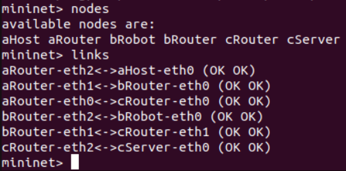
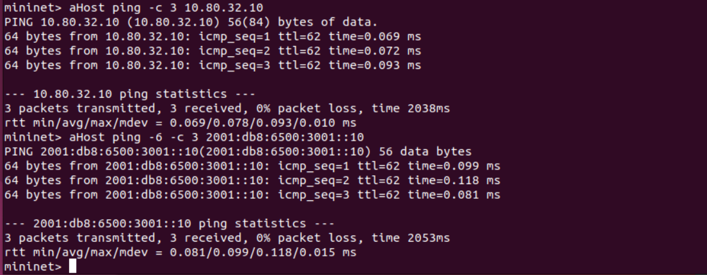
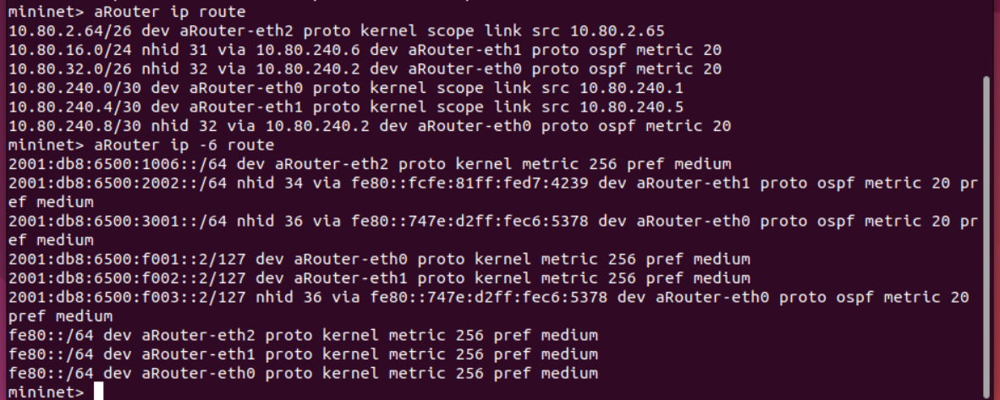
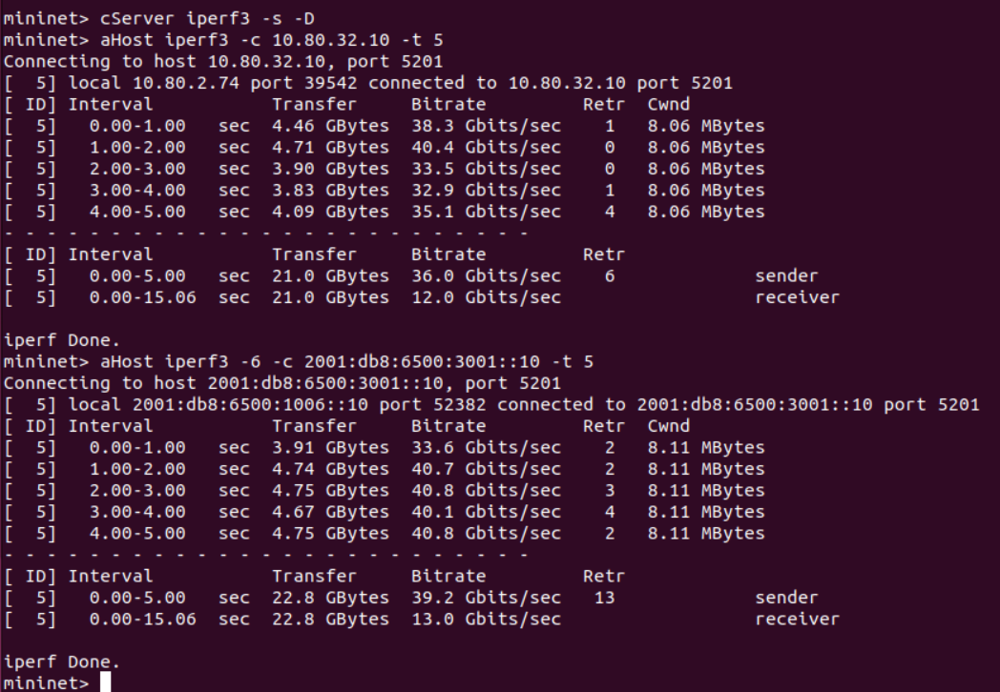
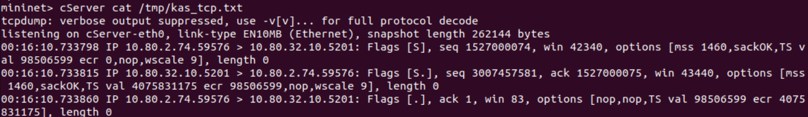
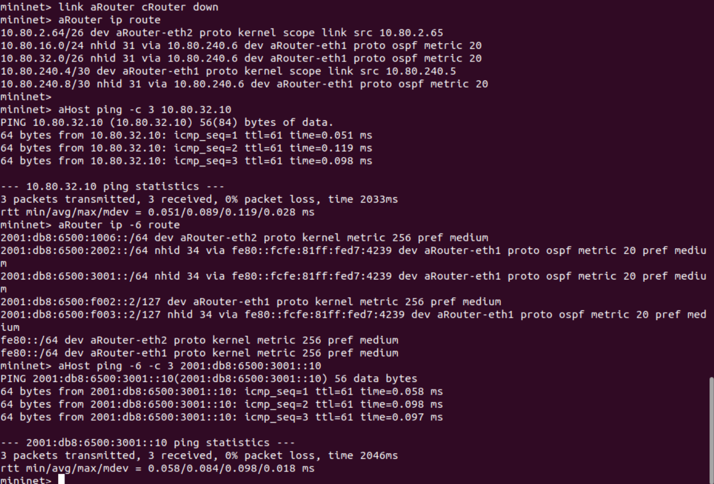

## 7. IPMininet Implementation and Validation

### 7.1 Representative topology and configuration

A reduced KAS routed network was implemented in the course IPMininet VM using `kas.py`. The model contains three routers (`aRouter`, `bRouter`, `cRouter`), three end hosts (`aHost`, `bRobot`, `cServer`), the three inter-site links A–C, A–B and B–C, and one representative LAN at each site. The three distribution switches in the production design are not emulated separately; their representative LAN gateways reside on the corresponding site routers. This preserves the inter-site Layer-3 paths but does not validate the production VLAN/ACL or switching configuration.

| Lab link or LAN | IPv4 addresses / network | IPv6 addresses / network | Configured OSPF metric |
| --- | --- | --- | ---: |
| A–C WAN | `10.80.240.1/30` ↔ `10.80.240.2/30` | `2001:db8:6500:f001::2/127` ↔ `...::3/127` | 10 |
| A–B WAN | `10.80.240.5/30` ↔ `10.80.240.6/30` | `2001:db8:6500:f002::2/127` ↔ `...::3/127` | 50 |
| B–C WAN | `10.80.240.9/30` ↔ `10.80.240.10/30` | `2001:db8:6500:f003::2/127` ↔ `...::3/127` | 50 |
| Site A engineering LAN | `10.80.2.64/26`; host `.74`, gateway `.65` | `2001:db8:6500:1006::/64`; host `::10`, gateway `::1` | — |
| Site B robotics LAN | `10.80.16.0/24`; host `.10`, gateway `.1` | `2001:db8:6500:2002::/64`; host `::10`, gateway `::1` | — |
| Site C server LAN | `10.80.32.0/26`; host `.10`, gateway `.1` | `2001:db8:6500:3001::/64`; host `::10`, gateway `::1` | — |

The script assigns explicit IPv4/IPv6 addresses and gateway routes and uses `igp_metric` for WAN-link OSPF costs. The course VM's default IPMininet router setup runs dynamic OSPFv2 and OSPFv3. `sudo python3 kas.py` started the topology and opened the IPMininet CLI. The `nodes` and `links` output confirms all six nodes and six links were present and operational.

*Figure 7.1. Nodes and link inventory for the representative KAS IPMininet topology. All six links report `(OK OK)`.*

### 7.2 Dual-stack connectivity

From `aHost`, the IPv4 command `ping -c 3 10.80.32.10` sent and received three packets with **0% loss** (mean RTT **0.078 ms**). The analogous IPv6 command `ping -6 -c 3 2001:db8:6500:3001::10` also returned three replies with **0% loss** (mean RTT **0.099 ms**). This verifies end-to-end connectivity for both address families in the normal A–C topology.

*Figure 7.2. Successful IPv4 and IPv6 connectivity from the Site A engineering host to the Site C server.*

### 7.3 Dynamic routing and forwarding entries

The `aRouter ip route` output contained OSPF-learned `10.80.32.0/26` via `10.80.240.2`, outgoing `aRouter-eth0` toward Site C, and `10.80.16.0/24` via `10.80.240.6`, outgoing `aRouter-eth1` toward Site B. The corresponding `aRouter ip -6 route` output contained `2001:db8:6500:3001::/64` via the Site C neighbor on `aRouter-eth0` and `2001:db8:6500:2002::/64` via the Site B neighbor on `aRouter-eth1`. The IPv6 next hops were link-local addresses selected by OSPFv3.

*Figure 7.3. Site A IPv4 and IPv6 forwarding entries after OSPFv2 and OSPFv3 converged.*

The OSPF interface checks with `vtysh -c "show ip ospf interface ..."` independently confirmed **Cost 10** on the A–C interface and **Cost 50** on the A–B interface. Both interfaces had one fully adjacent neighbor in Area 0. The displayed Linux routing-table `metric 20` is not the configured per-interface OSPF cost. The VM used OSPF Hello/Dead intervals of **200 ms/1 s**, whereas the production design proposes **10 s/40 s**; the lab timers are not a claimed production failover guarantee.

### 7.4 TCP throughput measurement

An `iperf3` server was started on `cServer` with `iperf3 -s -D`. Two five-second client tests were run from `aHost`:

| Test | Command | Sender transfer | Sender bitrate | Sender retransmissions | Receiver summary |
| --- | --- | ---: | ---: | ---: | --- |
| IPv4 | `iperf3 -c 10.80.32.10 -t 5` | 21.0 GBytes | 36.0 Gbit/s | 6 | 12.0 Gbit/s over 15.06 s |
| IPv6 | `iperf3 -6 -c 2001:db8:6500:3001::10 -t 5` | 22.8 GBytes | 39.2 Gbit/s | 13 | 13.0 Gbit/s over 15.06 s |

Both TCP tests completed. These values do **not** measure the 10 Gb/s production WAN: the emulated links were not rate-limited or given the production propagation delays, and the results depend on VM/host CPU, scheduling and virtual-network performance. The receiver summaries also covered about 15 s rather than the client's five-second measurement interval; these differently timed averages are not directly comparable. Consequently, the measured bitrates should not be presented as achievable physical-WAN throughput.

*Figure 7.4. IPv4 and IPv6 `iperf3` transfer summaries from the Site A host to the Site C server.*

### 7.5 TCP three-way handshake

A packet capture on `cServer-eth0` (`tcpdump -nn -i cServer-eth0 -c 12 'tcp port 5201'`) recorded the setup of an IPv4 TCP connection from **10.80.2.74:59576** to **10.80.32.10:5201**. The captured SYN (`[S]`), reverse-direction SYN-ACK (`[S.]`) and final ACK (`[.]`) establish that the handshake completed. Although the capture reported kernel-dropped packets under load, these three setup segments were present in the output.

*Figure 7.5. TCP SYN, SYN-ACK and ACK observed in a `tcpdump` capture at the Site C server.*

### 7.6 A–C WAN failure and recovery

After confirming normal routing through the direct A–C link, the command `link aRouter cRouter down` disconnected that WAN edge. The route on `aRouter` for `10.80.32.0/26` moved from **`10.80.240.2` on `aRouter-eth0`** to **`10.80.240.6` on `aRouter-eth1`**, indicating forwarding through RB. The IPv6 route to `2001:db8:6500:3001::/64` likewise moved to `aRouter-eth1`. Thus, both OSPFv2 and OSPFv3 selected the A–B–C backup path.

With A–C still down, IPv4 and IPv6 pings from `aHost` to `cServer` each returned **3/3 replies with 0% loss** after convergence. The IPv4/IPv6 reply hop values were consistent with traversing an additional router. These tests demonstrate **restored reachability after convergence**, not a measured convergence time or proof of zero transient packet loss.

*Figure 7.6. With A–C down, both address families route via Site B and retain end-to-end connectivity.*

Finally, `link aRouter cRouter up` restored the direct link. On `aRouter`, `ip route get 10.80.32.10` again resolved via **`10.80.240.2` on `aRouter-eth0`**, and `ip -6 route get 2001:db8:6500:3001::10` again used `aRouter-eth0`. A final IPv4 ping returned **3/3 replies with 0% loss**. The link restoration and route preference therefore behaved as expected.

### 7.7 Scope and limitations

This representative lab validates the dual-stack routed topology, OSPF path selection, TCP connection establishment, throughput measurement, and WAN-link failover. It does not reproduce every production VLAN, distribution-switch adjacency, ACL, BGP peering or NAT44 function. Link capacities and delays from the paper design were not applied as traffic-control limits, so throughput and RTT figures are specific to the emulation. The recorded screenshots are selected experimental outputs, and the executable topology is provided separately in `kas.py`.
