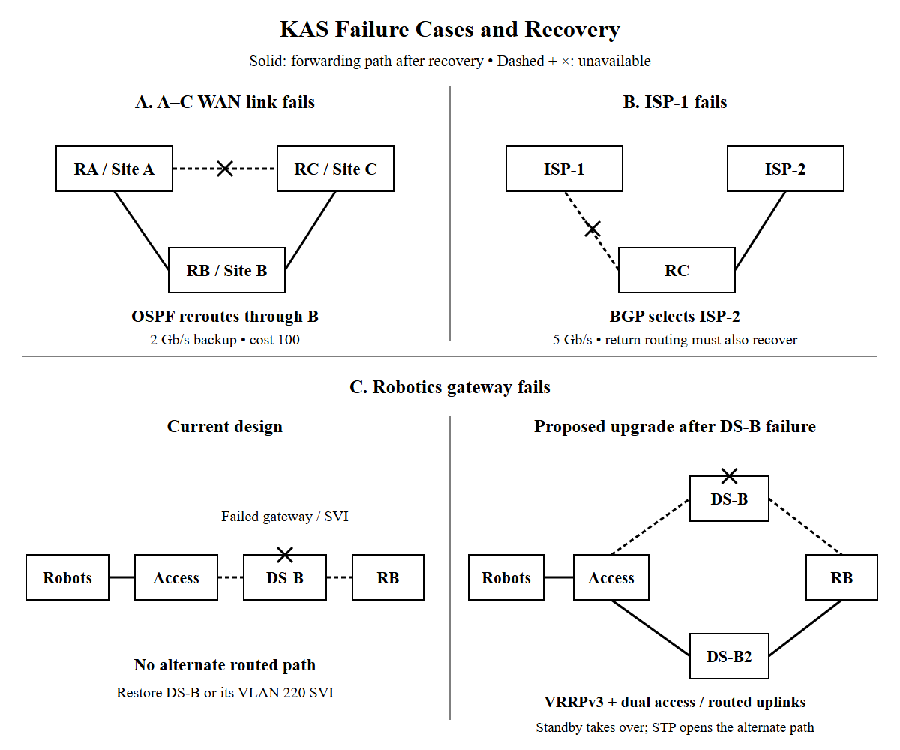

## 8. Failure Analysis, Operations, and Design Review

The three cases below follow each failure from the initial disruption through route recovery and its effect on TCP. Each assumes that all other devices and links remain operational.

*Figure 8.1. Failure paths for both address families. The lower-right view shows the proposed upgrade in Section 8.4.*

### 8.1 Failure A: A-C WAN link fails during a download

**Immediate effect.** Packets sent over the failed A-C link are lost, stalling the download described in Section 6. During the route change, packets already in flight may also arrive out of order.

**Control plane.** A physical link-down indication lets RA and RC begin failure processing immediately. If the interface stays up but Hellos stop arriving, OSPF detects the lost neighbor when the proposed 40-second Dead interval expires; Hellos are normally sent every 10 seconds. The routers then flood updated link-state information, run SPF, update the RIB, and install new FIB entries. OSPFv2 and OSPFv3 converge independently, so their recovery times may differ. The detection timers alone do not determine total recovery time.

**Stable path.** With the costs defined in Section 4, A-C at cost 10 is replaced by A-B-C at cost `50 + 50 = 100`. Download data crosses RC → RB → RA, with ACKs returning in the opposite direction. On RA, the repository's IPv4 next hop changes from `10.80.240.2` (RC) to `10.80.240.6` (RB); the IPv6 next-hop router also changes to RB. The backup shares its 2 Gb/s bottleneck with B's traffic and has `10 + 12 = 22 ms` of one-way WAN propagation, giving a minimum 44 ms round-trip propagation delay. When A-C and its adjacencies recover, both protocols return to the lower-cost direct route. Neither state uses ECMP.

**TCP impact.** Because addresses and ports remain unchanged, existing connections can resume if connectivity returns before TCP or the application times out. TCP retransmits missing data and may reduce its congestion window after loss. Even after recovery, the backup path's lower capacity and greater delay are likely to reduce throughput.

### 8.2 Failure B: ISP-1 fails during IPv4 and IPv6 sessions

**Immediate effect.** Internet packets are lost while RC or external networks still forward them toward ISP-1. Internal KAS traffic continues over the WAN.

**Control plane.** Under Section 5's import policy, RC accepts only defaults, with Local Preference 200 for ISP-1 and 100 for ISP-2. Once ISP-1's defaults become unusable, RC selects ISP-2 and updates its FIB. The proposed BGP Keepalive and Hold intervals are 30 and 90 seconds; a physical link-down indication can trigger earlier detection. RC continues advertising an internal default for each address family while a usable upstream default remains. IPv4 and IPv6 are evaluated independently. [RFC 4271](https://www.rfc-editor.org/rfc/rfc4271.html#section-9.1)

**Stable path.** Outbound Internet traffic follows KAS → RC → ISP-2 over the 5 Gb/s circuit. RC continues advertising both public aggregates through ISP-2 with two additional AS65050 prepends. Return traffic recovers only after external networks select that path, so RC's outbound change alone is insufficient to restore a session. Internal WAN paths remain unchanged. When ISP-1 supplies usable defaults again, Local Preference makes it the preferred outbound provider; the return path still depends on external routing policies and convergence.

**TCP impact.** The design requires RC to retain its NAT44 mappings, including `203.0.113.17` and the existing translated ports, when the outgoing provider changes. Private-IPv4 sessions can then resume if those mappings remain valid and return routing recovers before endpoint timeouts. Public-server IPv4 and native IPv6 sessions keep their addresses without translation, but also depend on timely route recovery. All may experience loss and retransmissions. The lab did not test NAT-state retention or session survival.

### 8.3 Failure C: Site B robotics gateway fails

**Immediate effect.** VLAN 220 loses its IPv4 gateway, `10.80.16.1`, and IPv6 default router, `fe80::1`, stopping robot-to-server traffic and remote engineering control. The effect on local traffic depends on the failure: an SVI-only outage can leave same-VLAN switching operational, while a complete DS-B outage removes all paths through that switch. Endpoints on the same working access switch may still communicate.

**Control plane.** If DS-B detects that its robotics SVI is down, it withdraws the VLAN's prefixes from both OSPF versions. If the entire switch fails, RB detects the lost adjacency and OSPF removes paths through DS-B. Neither ARP nor Neighbor Discovery can provide a replacement gateway because none is configured. A forwarding fault that leaves the SVI and adjacency up may leave stale routes until operational checks detect it.

**Stable path.** VLAN 220 remains without routed access until DS-B or its SVI is restored. The WAN triangle offers no alternative to this local gateway. An SVI-only outage can leave B's other VLANs operational, whereas a complete DS-B failure removes every VLAN gateway at B.

**TCP impact.** Connections crossing the gateway stop receiving acknowledgments and retransmit until connectivity returns or they time out. A short repair may allow them to resume if both endpoints retain their connection state. Connections within the same VLAN on a working access switch can remain active.

### 8.4 Engineering review

Local gateway availability is the main weakness: losing a site's sole distribution switch removes its gateways even when every WAN circuit is healthy. Internet access has a similar dependency on RC, which remains a single point of failure despite the two providers.

The first upgrade would add a second distribution switch at B to protect robotics access. It would require:

- An uplink from each access switch to both distribution switches, plus independent routed uplinks from those switches to RB.
- VRRPv3 for IPv4 and IPv6 gateway failover, using the existing gateway addresses as virtual addresses and assigning separate addresses to each switch. [RFC 9568](https://www.rfc-editor.org/rfc/rfc9568.html#section-1)
- Primary and secondary STP roots, with alternate paths blocked during normal operation and the active gateways aligned with the primary root.
